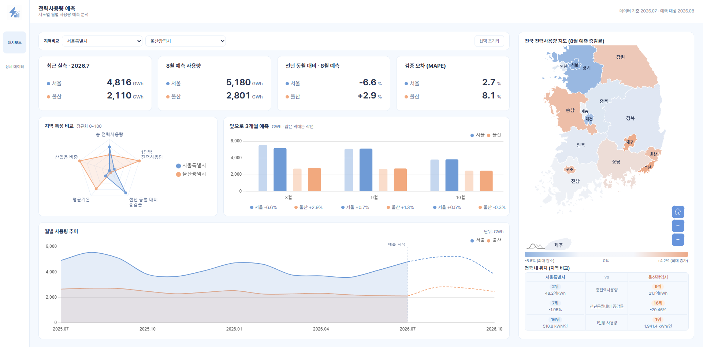
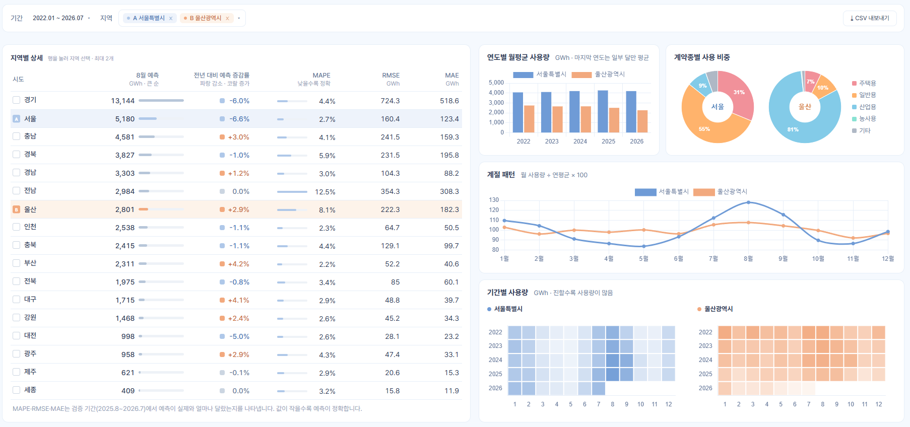

# 전력사용량 예측 대시보드

> 전국 17개 시도의 월별 전력사용량을 비교하고, 향후 3개월을 예측해 보여주는 대시보드


## 개요

| 구분 | 내용 |
| --- | --- |
| 팀 | HelloWorld (4인) |
| 기간 | 2026.09.18 ~ 10.16 (약 4주) |
| 내 역할 | 팀장 · 사이트 뼈대와 DB · Git 관리 · 레이더·상세 차트 · 모델 검증 |
| 작업일지 | [Notion 작업일지](https://app.notion.com/p/3df5abab4a9a81f3a8f3df6d1ec97256) |

## 화면





## 주요 기능

- **지도**: 시도별 8월 예측 증감률을 색으로 표시, 최대 2곳을 골라 비교
- **요약·예측**: 최근 실적, 향후 3개월 예측, 전년 동월 대비, 검증 오차(MAPE)
- **차트**: 월별 추이(예측 구간은 점선), 증감 순위, 계약종별 도넛, 지역 특성 레이더
- **상세 페이지**: 지역별 수치, 연도별 월평균·계절 패턴·기간별 히트맵, CSV 다운로드

지역을 고르면 `sessionStorage`와 이벤트(`region:selected`)로 모든 차트가 새로고침 없이 같은 지역으로 갱신됩니다.

## 구조

```
전력·기상 자료 → pandas 정리 → 모델 학습·검증
                                  ↓ 예측값을 미리 계산해 저장
        MariaDB (region · monthly_data · forecast · backtest)
                                  ↓ 조회만 수행
        Spring Boot · MyBatis · Thymeleaf → Chart.js · amCharts
```

## 예측 모델

- **데이터**: 17개 시도 × 55개월(2022.01 ~ 2026.07), 935행. 전력사용량 + 날씨(냉방도일·난방도일·폭염·한파·강수·습도)
- **분리**: 시간순. 학습 731행 / 검증 204행(2025.08 ~ 2026.07)
- **비교**: Random Forest · XGBoost · LightGBM, 그리고 "작년 같은 달 값 그대로" 기준선

| 모델 | MAPE |
| --- | --- |
| 전년동월 그대로 (기준선) | **3.73%** |
| Random Forest (최종 선택) | 4.11% |
| LightGBM | 4.41% |
| XGBoost | 4.59% |

세 모델 중 Random Forest가 가장 좋아 선택했지만, **단순 기준선은 넘지 못했습니다.** 아래 한계에서 그대로 밝힙니다.

## 문제 해결

**1. 랜덤 분리로 나온 "좋은 점수"가 누수였던 문제** ([일지](https://app.notion.com/p/3e45abab4a9a8157aa99ce7a461a2c82))
- 랜덤 분리 MAPE 3.52%가 시간순(4.11%)보다 좋아 보였지만, 검증 187행 중 119행(64%)의 정답이 학습 데이터의 전년동월 칸에 들어 있었습니다.
- 시간순 분리로 바꾸고 팀 전체 설정을 통일했습니다.

**2. 강원도만 오차가 24%였던 문제**
- 세대수가 사실상 "지역 번호"처럼 쓰여, 강원도를 충청북도처럼 예측했습니다.
- 지역 규모는 시도 원핫과 전년동월이 이미 담고 있어 세대수를 제거했고, 강원도 오차가 24.4% → 7.05%로 줄었습니다. 전체 평균만 봤다면 묻혔을 문제였습니다.

**3. 4명이 한 화면을 만들 때의 병합 충돌** ([일지](https://app.notion.com/p/3ea5abab4a9a81b5ad39cf4ed8a8f9f4))
- Thymeleaf fragment로 화면을 조각내고 파일 소유자를 정해, 각자 자기 파일만 수정하게 했습니다. 이름 충돌은 접두사 규칙으로 막았습니다.

## 한계와 개선 방향

- **기준선 미달**: Random Forest 4.11% vs 작년 값 복사 3.73%. 직전 1~3개월 사용량(lag) 등을 추가해 개선할 계획입니다.
- **산업형 지역**(울산 약 8%, 전남 약 12%): 공장 가동률 같은 산업 신호가 입력에 없어 오차가 큽니다.
- **미래 날씨**는 알 수 없어 2022~2024년 같은 달 평균으로 가정했습니다. 4.11%가 미래 오차를 그대로 보장하지 않습니다.

## 실행 방법

1. MariaDB에 `schema.sql`을 실행하고 데이터를 적재합니다.
2. `application.yaml`에 DB 접속 정보를 입력합니다.
3. `./gradlew bootRun`으로 실행한 뒤 브라우저로 접속합니다.

## 배운 점

1. **검증 조건을 의심하기** — 랜덤 분리는 좋아 보였지만 누수였습니다.
2. **쪼개 봐야 보인다** — 강원도 24%는 전체 평균에 묻혀 있었습니다.
3. **기준선을 먼저 계산하기** — 복잡한 모델이 단순한 방법보다 정확하다는 보장은 없습니다.

## 프로젝트 시리즈

1차 냉·난방 AS기사 스케줄 관리 · 2차 전력사용량 예측 대시보드 (이 저장소) · 3차 해상교통 안전경로 예측 시스템
